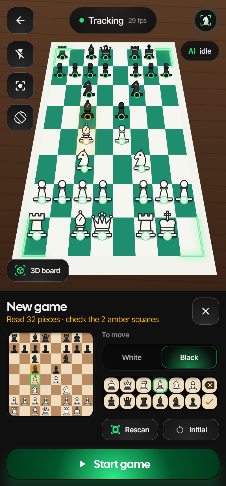
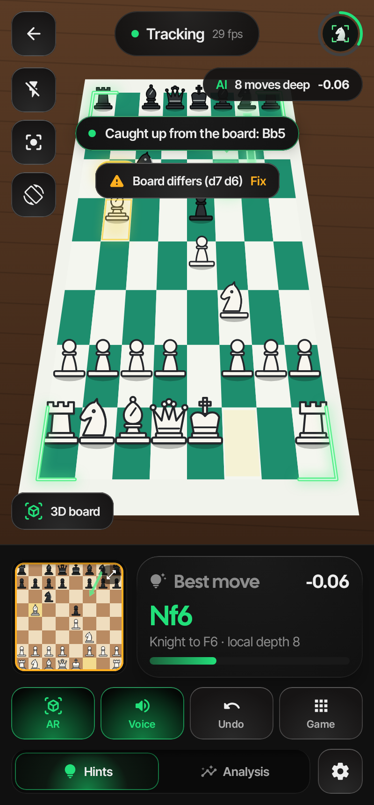

# ChessLens

**Лучший ход — прямо на доске.** Android-приложение, которое смотрит на настоящую шахматную доску через камеру,
следит за партией и рисует подсказки движка поверх доски в дополненной реальности: светящиеся траектории ходов,
плашки с оценкой, режим анализа с летающей шкалой оценки, стрелками нескольких линий, угрозами и эффектами.

| Подсказки на реальной доске (3D) | Доска на экране монитора (2D) |
|---|---|
|  |  |

| Режим анализа |
|---|
|  |

| Новая партия с любой позиции: камера прочитала позицию, два поля под вопросом, ход чёрных | Доска сверена: пропущенный ход доигран, расхождение — с кнопкой Fix |
|---|---|
|  |  |

| Главный экран | Шах + «Brilliant !!» | Доска анализа | Настройки |
|---|---|---|---|
|  |  |  |  |

> Скриншоты рендерятся автоматически (Robolectric + Roborazzi) на синтетической сцене с доской —
> на телефоне вместо неё будет изображение с камеры.

## Возможности

**AR-подсказки (режим «Hints»)**
- Неоновые уголки, «прилипающие» к доске (трекинг по оптическому потоку — оверлей держится, когда двигаешь телефон).
- Лучший ход: светящаяся лента-траектория (у коня — Г-образная) с бегущим бликом, подсветка поля назначения,
  зелёная плашка `Nf6 +0.26` над полем с анимацией появления.
- Последний ход соперника — жёлтая подсветка и плашка `c4`.
- «Сканирующие» кольца вокруг фигур при захвате доски и после каждого распознанного хода.
- Красная пульсирующая плашка `CHECK` над королём.
- Озвучка хода («Bishop takes D2, check») с анимированной волной.
- Бейджи качества хода после каждого хода: Brilliant `!!`, Great `!`, Best `★`, Excellent, Good, Book,
  Inaccuracy `?!`, Mistake `?`, Blunder `??` — с разлетающимися искрами.

**Режим анализа («Analysis»)**
- Летающая шкала оценки рядом с доской: наклоняется вместе с перспективой доски, парит с тенью,
  пружинисто анимируется и искрит при резких скачках оценки.
- Стрелки трёх лучших линий (зелёная / синяя / фиолетовая) с оценками.
- Красная пунктирная стрелка угрозы соперника (null-move поиск).
- Нумерованное продолжение главного варианта.
- Висящие фигуры (SEE) — красные кольца с `!`; тепловая карта контроля полей.
- Отдельный экран анализа: 2D-доска, шкала, линии движка, график оценки, точность игроков, список ходов с бейджами,
  навигация по партии и ходы с доски.

**Два режима зрения: 3D-доска и 2D-экран**
- **3D board** — настоящая доска с фигурами: учитывается перспектива и то, что высокие фигуры
  заслоняют соседние поля (поле сравнивается у основания фигуры), ход читается после того, как рука ушла.
- **2D screen** — доска на мониторе, планшете или распечатке (chess.com, lichess, книги): клетки
  сравниваются по структуре (нормированная корреляция), поэтому подсветка последнего хода, которую
  рисуют сайты, не путает распознавание; анимации короче, ход читается быстрее.
- Оба режима распознают **ход + мгновенный ответ** соперника, если камера не успела увидеть позицию между
  ними (премувы и блиц онлайн).
- Переключение: вкладки на главном экране, кнопка «3D board / 2D screen» на экране камеры, настройки.

**Мини-доска → доска анализа**
- Тап по мини-доске открывает доску анализа с движком: там можно сходить пропущенный ход, вернуться
  назад или нажать ✎ **Edit position** и расставить фигуры вручную (палитра + чей ход).
  То же редактирование есть в меню *Game → Edit position* (там можно и пересканировать доску).

**Новая партия с любой позиции**
- *Game → New game* сначала сканирует доску: по полю проходит линия сканера, через пару секунд позиция
  уже стоит на мини-доске. Можно сесть за партию, начатую без приложения.
- Камера видит, где стоят фигуры и какого они цвета; какая это фигура, восстанавливается шахматной
  логикой: позиция сверяется с ходом партии и позициями на 1–2 хода вперёд, иначе фигуры начальной
  расстановки «разводятся» по занятым полям самым правдоподобным образом (фигуры чаще стоят дома, пешки
  ходят только вперёд, слон не меняет цвет поля, рокировка — один ход). Сторона белых определяется сама.
- Поля, в которых скан не уверен, подсвечены жёлтым — и на мини-доске, и на настоящей доске в AR.
  Тап по полю → выбор фигуры в палитре (✓ — «скан прав»).
- Переключатель **White / Black** — чей сейчас ход (по умолчанию — догадка по числу сделанных ходов),
  права на рокировку выставляются по расстановке. Кнопка **Initial** — сразу начальная позиция.
- Высокие фигуры заслоняют поля за собой, поэтому для скана телефон лучше держать повыше, глядя на доску
  сверху; если ракурс слишком низкий, приложение попросит поднять телефон (или можно сканировать как есть).

**Компьютерное зрение (OpenCV)**
- Доска ищется по внутренним X-углам (где сходятся четыре клетки): детектор ChESS → RANSAC-подгонка
  решётки → выбор окна 8×8 по известной позиции (где стоят фигуры и какого они цвета; это же даёт
  сторону белых). Переживает фигуры, руки, складной шов и доску, уходящую за край кадра.
- Во время съёмки с рук сетка каждые несколько кадров заново «пристыковывается» к решётке, между
  ними её ведёт оптический поток.
- Параллакс высоких фигур при движении телефона учтён: эталон «до хода» обновляется, пока над доской
  ничего не происходит, сравнение идёт с самым близким по ракурсу снимком, тень фигуры на соседнем
  поле считается объяснённой, лежащая над доской рука распознаётся и не принимается за ход.
- Ручная настройка углов (⌖), если автоматом не получилось.
- Определение ориентации (с какой стороны белые) по начальной расстановке, поворот / переворот вручную.
- Распознавание хода без классификатора фигур: после того как рука ушла и кадр стабилизировался,
  сравниваются клетки с эталоном и выбирается легальный ход, лучше всего объясняющий изменения
  (рокировка, взятие на проходе, превращение — тоже).
- Если ход прочитан неуверенно, приложение напишет, какой ход засчитан, чтобы ошибку можно было сразу
  отменить кнопкой Undo.
- **Нелегальный ход** называется прямо: «It's Black's move» (если походила не та сторона — скорее всего,
  пропущен ход соперника), «the king can't go to e2», «would leave the king in check» — плюс голосом
  «Illegal move». Вместо общего «Couldn't read that move».
- **Сверка доски каждые полсекунды.** Пока над доской ничего не происходит, позиция на доске сравнивается
  с позицией в приложении (и с позициями на 1–2 хода вперёд, и с вариантом «последний ход прочитан
  неверно»). Пропущенный ход доигрывается сам («Caught up from the board: Bb5+»), неверно прочитанный —
  исправляется («Fixed: Nh3 → Nf3»). Если объяснить расхождение не получается, появляется жёлтая плашка
  «Board differs (…) · Fix» — тап открывает скан позиции.
- **Сетка больше не «съезжает» на клетку.** Если трекинг уплыл больше чем на полклетки, при пристыковке
  к решётке сравниваются соседние блоки 8×8: у верного все 49 внутренних углов на месте, у сдвинутого
  целый ряд попадает на край доски. После такой поправки эталонный кадр снимается заново.
- **Рука у края доски** определяется по полосе вокруг доски (рамка и стол): рука, тянущаяся к доске,
  её пересекает. Только яркость, без цвета — при тёплом домашнем свете серая доска и кожа почти одного
  цвета (старый детектор по цвету кожи из-за этого «видел руку» всё время и не читал ходы). Эталон
  полосы обновляется после каждого хода, а неподвижный предмет поглощается через несколько секунд.
- На кадр уходит ~3 мс на компьютере (сетка во время трекинга подгоняется от прошлого положения,
  а не ищется заново), буферы кадров переиспользуются — без пауз сборщика мусора.

**Движок**
- Собственный движок на Kotlin: итеративное углубление, PVS, хеш-таблица, null-move, LMR, futility,
  killer/history, quiescence, MultiPV, PeSTO-оценка. Perft-тесты проходят.
- Опционально — облачный анализ Lichess (глубокие оценки Stockfish для известных позиций).

## Как пользоваться

1. Установи APK (см. ниже), запусти **Start camera** и разреши доступ к камере.
2. Наведи камеру на доску, чтобы она целиком была в кадре (лучше сверху-сбоку, как в видео). Когда доска найдена,
   уголки загорятся зелёным, а по фигурам пройдут кольца.
3. Партия уже идёт? *Game → New game*: подержи телефон над доской, проверь жёлтые поля, выбери, чей ход,
   и нажми **Start game**.
4. В настройках выбери, за кого играешь (`White` / `Black` / `Both`). Подсказка появляется в твой ход,
   ход соперника подсвечивается жёлтым.
5. Делай ходы на настоящей доске — приложение распознаёт их само. Переключатель **Hints / Analysis** —
   режим подсказок или полный анализ.
6. Если доска распознана со сдвигом — *Game → Adjust board corners*. Если белые определились не с той стороны —
   *Rotate board* / *Flip board*.

## Сборка

```bash
./gradlew :app:assembleRelease          # APK по архитектурам в app/build/outputs/apk/release
./gradlew :chess:test :vision:test      # тесты движка и зрения
./gradlew :app:recordRoborazziDebug     # скриншоты в app/build/outputs/roborazzi
```

Нужны JDK 17+ и Android SDK (compileSdk 35). Для телефона бери `app-arm64-v8a-release.apk`
(подписан debug-ключом, ставится напрямую). CI в GitHub Actions собирает APK и скриншоты на каждый push.

## Структура

| Модуль | Что внутри |
|---|---|
| `chess/` | Правила, FEN/SAN, движок, классификатор ходов, SEE (чистый Kotlin, JVM-тесты) |
| `vision/` | Детектор доски, трекер, детектор ходов, гомографии (OpenCV, тесты на синтетических кадрах) |
| `app/` | Jetpack Compose UI, CameraX, AR-оверлей, режим анализа, TTS |

## Проверка на своём видео

Можно прогнать любую запись партии через тот же код, что работает в приложении:

```bash
ffmpeg -i game.mp4 -vf "scale=360:640,format=gray" frames/f_%04d.png
./gradlew :vision:test --tests '*VideoReplay*' -Dchesslens.replayDir=$PWD/frames -Dchesslens.debugDir=$PWD/out
```

В `out/replay.log` — найденные ходы по кадрам, в `out/r_*.jpg` — кадры с наложенной сеткой.

## Почему без нейросетей с Hugging Face

Проверена самая подходящая открытая модель для телефона — `yamero999/chess-piece-detection-yolo11n`
(Apache-2.0, ONNX, 10 МБ) — на кадрах реальной партии: из ~28 фигур она находит 5–11 и почти все
называет «чёрным слоном». Остальные кандидаты либо под AGPL-3.0 (YOLOv8 от Ultralytics — заставило бы
открыть всё приложение под AGPL), либо LGPL, либо обучены только на синтетических 2D-картинках.
ChessLens не нужен классификатор фигур: позиция известна из правил, а камера лишь определяет,
какие поля изменились. Это работает на любом наборе фигур и не требует модели.

## Дизайн

Тёмные «плиты» с подсветкой сверху, выпуклые кнопки и светящаяся главная кнопка — по мотивам
forgegui.com, с зелёным акцентом вместо синего. Шрифты Cal Sans и Inter Tight (OFL, лицензии в
`docs/licenses`). Подробности — в [DESIGN.md](DESIGN.md).

## Ограничения

- Ходы распознаются от известной позиции (начальной, отсканированной через New game или заданной FEN);
  каждый ход должен делаться целиком, пока камера видит доску.
- Скан не различает тип фигуры по виду: в необычных позициях (превращения, много разменов) жёлтых полей
  будет больше, и их нужно проверить вручную.
- Камера должна видеть все 64 поля; при сильных бликах или очень низком ракурсе детектор может ошибаться —
  тогда помогает ручная настройка углов.
