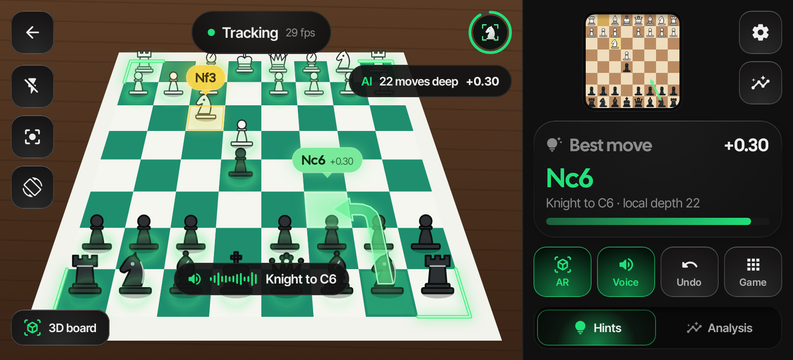
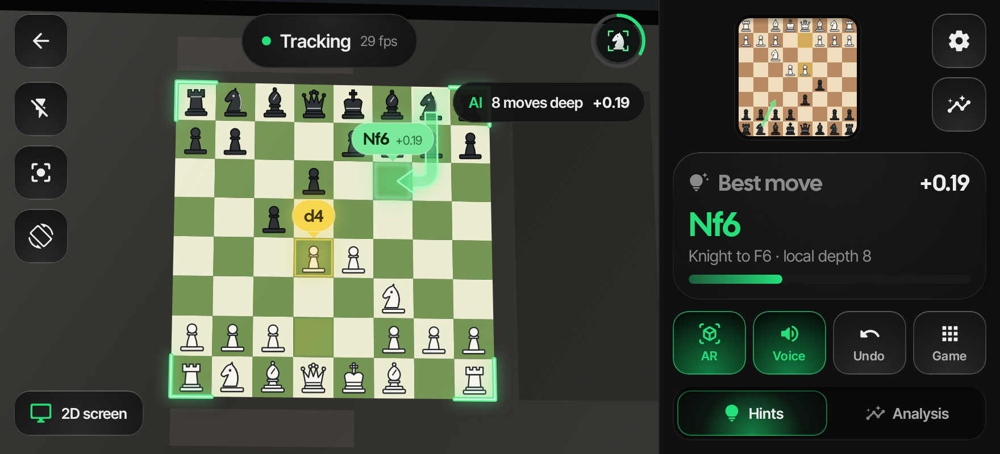
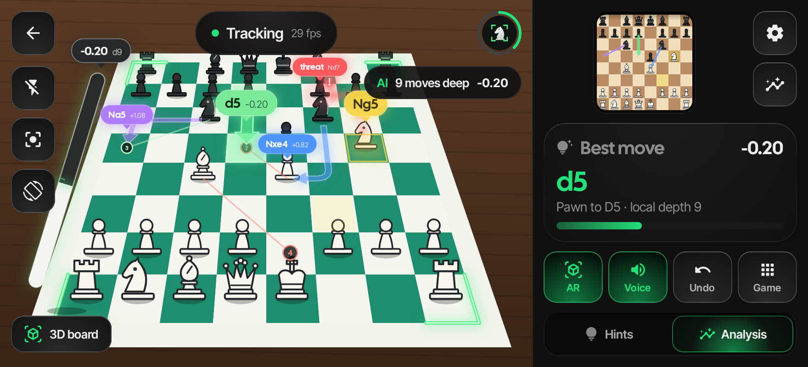
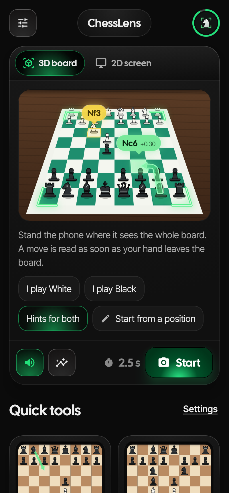
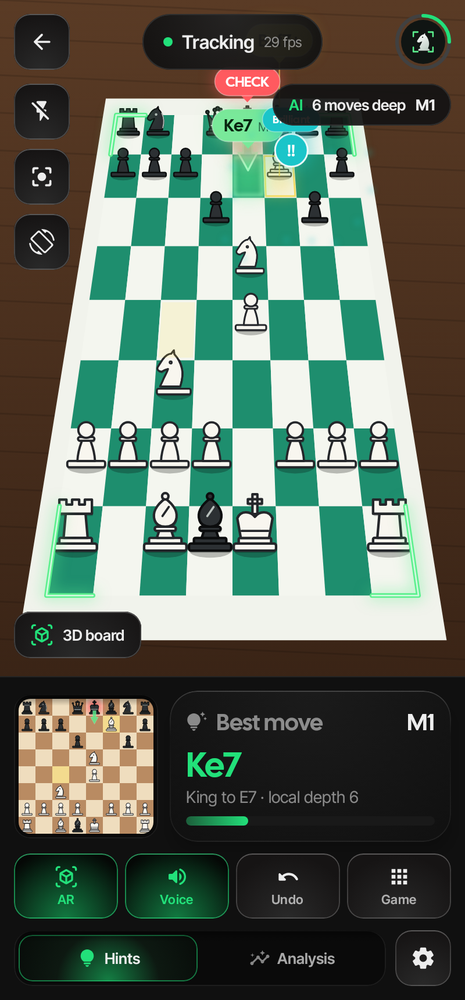
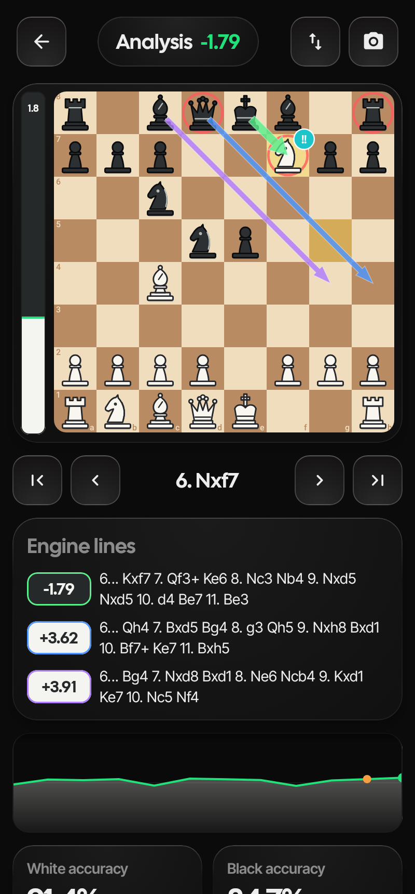
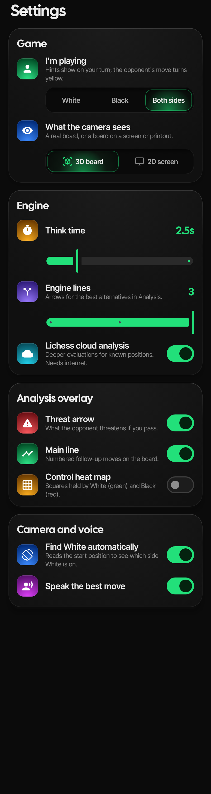

# ChessLens

**Лучший ход — прямо на доске.** Android-приложение, которое смотрит на настоящую шахматную доску через камеру,
следит за партией и рисует подсказки движка поверх доски в дополненной реальности: светящиеся траектории ходов,
плашки с оценкой, режим анализа с летающей шкалой оценки, стрелками нескольких линий, угрозами и эффектами.

| Подсказки на реальной доске (3D) | Доска на экране монитора (2D) |
|---|---|
|  |  |

| Режим анализа |
|---|
|  |

| Главный экран | Шах + «Brilliant !!» | Доска анализа | Настройки |
|---|---|---|---|
|  |  |  |  |

> Скриншоты рендерятся автоматически (Robolectric + Roborazzi) на синтетической сцене с доской —
> на телефоне вместо неё будет изображение с камеры.

## Возможности

**AR-подсказки (режим «Hints»)**
- Неоновые уголки, «прилипающие» к доске (трекинг по оптическому потоку — оверлей держится, когда двигаешь телефон).
- Лучший ход: светящаяся лента-траектория (у коня — Г-образная) с бегущим бликом, подсветка поля назначения,
  зелёная плашка `Nf6 +0.26` над полем с анимацией появления.
- Последний ход соперника — жёлтая подсветка и плашка `c4`.
- «Сканирующие» кольца вокруг фигур при захвате доски и после каждого распознанного хода.
- Красная пульсирующая плашка `CHECK` над королём.
- Озвучка хода («Bishop takes D2, check») с анимированной волной.
- Бейджи качества хода после каждого хода: Brilliant `!!`, Great `!`, Best `★`, Excellent, Good, Book,
  Inaccuracy `?!`, Mistake `?`, Blunder `??` — с разлетающимися искрами.

**Режим анализа («Analysis»)**
- Летающая шкала оценки рядом с доской: наклоняется вместе с перспективой доски, парит с тенью,
  пружинисто анимируется и искрит при резких скачках оценки.
- Стрелки трёх лучших линий (зелёная / синяя / фиолетовая) с оценками.
- Красная пунктирная стрелка угрозы соперника (null-move поиск).
- Нумерованное продолжение главного варианта.
- Висящие фигуры (SEE) — красные кольца с `!`; тепловая карта контроля полей.
- Отдельный экран анализа: 2D-доска, шкала, линии движка, график оценки, точность игроков, список ходов с бейджами,
  навигация по партии и ходы с доски.

**Два режима зрения: 3D-доска и 2D-экран**
- **3D board** — настоящая доска с фигурами: учитывается перспектива и то, что высокие фигуры
  заслоняют соседние поля (поле сравнивается у основания фигуры), ход читается после того, как рука ушла.
- **2D screen** — доска на мониторе, планшете или распечатке (chess.com, lichess, книги): клетки
  сравниваются по структуре (нормированная корреляция), поэтому подсветка последнего хода, которую
  рисуют сайты, не путает распознавание; анимации короче, ход читается быстрее.
- Оба режима распознают **ход + мгновенный ответ** соперника, если камера не успела увидеть позицию между
  ними (премувы и блиц онлайн).
- Переключение: вкладки на главном экране, кнопка «3D board / 2D screen» на экране камеры, настройки.

**Компьютерное зрение (OpenCV)**
- Автопоиск доски: четырёхугольники по контурам → подгонка решётки 9×9 по проекциям градиентов
  → доводка углов по линиям сетки. Ручная настройка углов (⌖), если автоматом не получилось.
- Определение ориентации (с какой стороны белые) по начальной расстановке, поворот / переворот вручную.
- Распознавание хода без классификатора фигур: после того как рука ушла и кадр стабилизировался,
  сравниваются клетки с эталоном и выбирается легальный ход, лучше всего объясняющий изменения
  (рокировка, взятие на проходе, превращение — тоже).
- Если ход не прочитался — тапни его на мини-доске.

**Движок**
- Собственный движок на Kotlin: итеративное углубление, PVS, хеш-таблица, null-move, LMR, futility,
  killer/history, quiescence, MultiPV, PeSTO-оценка. Perft-тесты проходят.
- Опционально — облачный анализ Lichess (глубокие оценки Stockfish для известных позиций).

## Как пользоваться

1. Установи APK (см. ниже), запусти **Start camera** и разреши доступ к камере.
2. Наведи камеру на доску, чтобы она целиком была в кадре (лучше сверху-сбоку, как в видео). Когда доска найдена,
   уголки загорятся зелёным, а по фигурам пройдут кольца.
3. В настройках выбери, за кого играешь (`White` / `Black` / `Both`). Подсказка появляется в твой ход,
   ход соперника подсвечивается жёлтым.
4. Делай ходы на настоящей доске — приложение распознаёт их само. Переключатель **Hints / Analysis** —
   режим подсказок или полный анализ.
5. Если доска распознана со сдвигом — *Game → Adjust board corners*. Если белые определились не с той стороны —
   *Rotate board* / *Flip board*.

## Сборка

```bash
./gradlew :app:assembleRelease          # APK по архитектурам в app/build/outputs/apk/release
./gradlew :chess:test :vision:test      # тесты движка и зрения
./gradlew :app:recordRoborazziDebug     # скриншоты в app/build/outputs/roborazzi
```

Нужны JDK 17+ и Android SDK (compileSdk 35). Для телефона бери `app-arm64-v8a-release.apk`
(подписан debug-ключом, ставится напрямую). CI в GitHub Actions собирает APK и скриншоты на каждый push.

## Структура

| Модуль | Что внутри |
|---|---|
| `chess/` | Правила, FEN/SAN, движок, классификатор ходов, SEE (чистый Kotlin, JVM-тесты) |
| `vision/` | Детектор доски, трекер, детектор ходов, гомографии (OpenCV, тесты на синтетических кадрах) |
| `app/` | Jetpack Compose UI, CameraX, AR-оверлей, режим анализа, TTS |

## Почему без нейросетей с Hugging Face

Проверена самая подходящая открытая модель для телефона — `yamero999/chess-piece-detection-yolo11n`
(Apache-2.0, ONNX, 10 МБ) — на кадрах реальной партии: из ~28 фигур она находит 5–11 и почти все
называет «чёрным слоном». Остальные кандидаты либо под AGPL-3.0 (YOLOv8 от Ultralytics — заставило бы
открыть всё приложение под AGPL), либо LGPL, либо обучены только на синтетических 2D-картинках.
ChessLens не нужен классификатор фигур: позиция известна из правил, а камера лишь определяет,
какие поля изменились. Это работает на любом наборе фигур и не требует модели.

## Дизайн

Тёмные «плиты» с подсветкой сверху, выпуклые кнопки и светящаяся главная кнопка — по мотивам
forgegui.com, с зелёным акцентом вместо синего. Шрифты Cal Sans и Inter Tight (OFL, лицензии в
`docs/licenses`). Подробности — в [DESIGN.md](DESIGN.md).

## Ограничения

- Распознавание ходов рассчитано на начало партии со стартовой позиции (или заданной через FEN) и на то,
  что каждый ход делается целиком, пока камера видит доску.
- Камера должна видеть все 64 поля; при сильных бликах или очень низком ракурсе детектор может ошибаться —
  тогда помогает ручная настройка углов.
